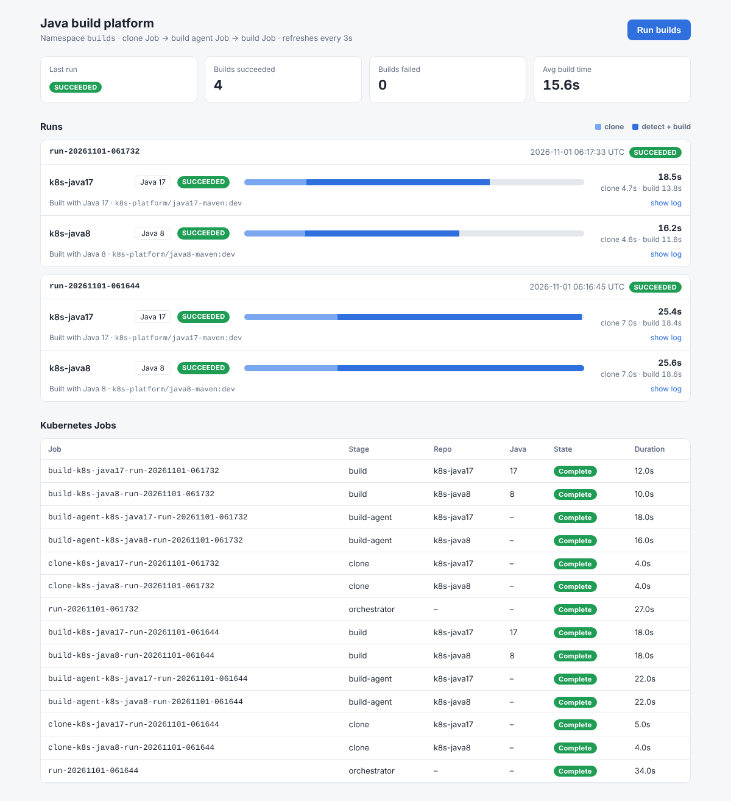

# k8s-platform

A small Java build platform you can run on a laptop, made for learning Kubernetes **Jobs** and
**PersistentVolumeClaims** hands-on. It clones two sample repos onto a shared PVC, works out which
Java version each one targets, builds it in a matching JDK image, and shows the results on a dashboard.

| Repo | What it is |
|---|---|
| [k8s-java8](https://github.com/tanmaypatil/k8s-java8) | Java 8 + Maven sample (inventory and pricing) |
| [k8s-java17](https://github.com/tanmaypatil/k8s-java17) | Java 17 + Maven sample (records, sealed types, switch expressions, text blocks) |
| **k8s-platform** (this repo) | Kubernetes manifests, build images, orchestrator, build agent and dashboard |



## How it works

```
 you / dashboard button
        │  kubectl create job --from=cronjob/orchestrator run-<timestamp>
        ▼
 ┌──────────────────┐   one thread per repo
 │ orchestrator Job │─────────────────────────────────────────────┐
 └──────────────────┘                                             │
        │ 1. clone Job (alpine/git)         writes                ▼
        │    git clone ──────────────────────────────▶  PVC "workspace"
        │ 2. build-agent Job                reads pom.xml        /workspace/runs/<build>/<repo>
        │    detects Java 8 or 17 ◀───────────────────           /workspace/m2       (Maven cache)
        │ 3. build Job (java8-maven or java17-maven)             /workspace/logs/<build>/<repo>.log
        │    mvn package ─────────────────────────────▶          /workspace/artifacts/<build>/<repo>
        ▼
 ConfigMap "build-status"  ◀── each step patches a JSON record per <build>.<repo>
        ▲
        └── dashboard Deployment reads it (plus live Jobs) and serves http://localhost:8080
```

The Kubernetes ideas each piece shows:

| Piece | Kubernetes concepts |
|---|---|
| `manifests/base/10-pvc.yaml` | PersistentVolumeClaim, dynamic provisioning, access modes. Every Job mounts the same volume. |
| `manifests/templates/clone-job.yaml` | Job, `backoffLimit` (retries), `activeDeadlineSeconds`, `ttlSecondsAfterFinished`, `$(VAR)` expansion |
| `manifests/templates/build-job.yaml` | Job with `backoffLimit: 0`, resource requests and limits, labels for querying |
| `manifests/base/40-orchestrator-cronjob.yaml` | A **suspended CronJob** used as a reusable Job template, plus the downward API (the Job name becomes the build id) |
| `manifests/base/20-rbac.yaml` | ServiceAccount, Role, RoleBinding. The agents can create Jobs, but only in `builds`. |
| `manifests/base/30-config.yaml` | ConfigMaps for settings (`envFrom`) and as a tiny status database |
| `manifests/base/50-dashboard.yaml` | Deployment, readiness probe, NodePort Service, read-only volume mount |

**How the Java version is picked.** `agent/build_agent.py` reads `pom.xml` and looks, in order, at
`maven-compiler-plugin` `<release>/<target>/<source>`, then the properties `maven.compiler.release`,
`maven.compiler.target`, `maven.compiler.source` and `java.version` (`1.8` means 8). It then picks the
lowest build image that is at least that version, from the `JAVA_<N>_IMAGE` entries in `platform-config`.
To add Java 21, build a `java21-maven` image and add `JAVA_21_IMAGE`.

## Where to run it

**Recommended: kind on your Mac.** You need Docker Desktop (or Colima) with about 4 CPUs and 6 GB of
memory, plus `brew install kind kubectl`. It's free, starts in about a minute, and `./scripts/down.sh`
wipes everything.

**Minikube** works too: `brew install minikube`, then `CLUSTER_TOOL=minikube ./scripts/up.sh`.

**Cloud:** the manifests are plain Kubernetes, so a small GKE Autopilot, EKS or DigitalOcean cluster
works. Push the three images to a registry (GHCR or Docker Hub), change the image names in
`manifests/base/30-config.yaml` and `40`/`50`, and `kubectl apply -k manifests/base`. A multi-node
cluster needs a `ReadWriteMany` storage class for the PVC (see the comment in `10-pvc.yaml`).
fly.io is not a good fit, because it is not a Kubernetes platform.

## Quick start (kind)

```bash
git clone https://github.com/tanmaypatil/k8s-platform && cd k8s-platform
./scripts/up.sh          # cluster + images + manifests (first run takes a few minutes)
open http://localhost:8080
./scripts/trigger.sh     # or press "Run builds" on the dashboard
./scripts/status.sh      # status table + Jobs from the terminal
```

The second run is noticeably faster than the first, because the Maven cache lives on the PVC.

## Hands-on: poke at it with kubectl

```bash
kubectl -n builds get pvc,pv                          # the claim and the volume provisioned for it
kubectl -n builds get cronjob,jobs,pods               # the orchestrator template, Jobs and their pods
kubectl -n builds get jobs -l k8s-platform/stage=build -L k8s-platform/repo,k8s-platform/java
kubectl -n builds logs job/build-k8s-java17-<build-id> # build output
kubectl -n builds get configmap build-status -o yaml  # the status records
kubectl -n builds exec deploy/dashboard -- ls -R /workspace/artifacts   # look inside the PVC
```

Run a single clone Job by hand, without the orchestrator:

```bash
export JOB_NAME=clone-manual BUILD_ID=manual REPO=k8s-java8 GIT_REF=main \
       REPO_URL=https://github.com/tanmaypatil/k8s-java8.git GIT_IMAGE=alpine/git:2.47.2
envsubst '$JOB_NAME $BUILD_ID $REPO $REPO_URL $GIT_REF $GIT_IMAGE' \
  < manifests/templates/clone-job.yaml | kubectl -n builds create -f -
kubectl -n builds wait --for=condition=complete job/clone-manual
kubectl -n builds logs job/clone-manual
```

Then build it by hand (pick the image yourself, which is what the build agent automates):

```bash
export JOB_NAME=build-manual JAVA_VERSION=8 BUILD_IMAGE=k8s-platform/java8-maven:dev
envsubst '$JOB_NAME $BUILD_ID $REPO $JAVA_VERSION $BUILD_IMAGE' \
  < manifests/templates/build-job.yaml | kubectl -n builds create -f -
kubectl -n builds logs -f job/build-manual
```

Things to try: build `k8s-java17` with the Java 8 image and watch it fail. Delete a running build
pod and see that `backoffLimit: 0` marks the Job failed. Add a third repo to `REPOS` in
`platform-config`.

## Repo layout

```
cluster/kind-config.yaml        kind cluster, maps NodePort 30080 -> localhost:8080
images/java8-maven/             JDK 8 + Maven build image
images/java17-maven/            JDK 17 + Maven build image
images/build-scripts/run-build.sh   entry point of both build images
images/agent/Dockerfile         Python + kubectl image for orchestrator, build agent and dashboard
agent/orchestrator.py           clone Job -> build-agent Job, per repo, in parallel
agent/build_agent.py            detect Java version, create build Job, record result
agent/status_store.py           build-status ConfigMap read/write (+ CLI table)
agent/kube.py                   kubectl helpers
dashboard/                      stdlib web server + single-page UI
manifests/base/                 kubectl apply -k manifests/base
manifests/templates/            Job templates rendered by the agents (or by envsubst)
scripts/                        up.sh, trigger.sh, status.sh, down.sh
```

## Behind a corporate proxy (optional)

Clone and build Jobs load an optional `build-env` ConfigMap (with `envFrom`) and mount an optional
`extra-ca` ConfigMap at `/etc/extra-ca`. On a normal home network you don't need either. Behind a
proxy, put `HTTPS_PROXY`, `GIT_SSL_CAINFO=/etc/extra-ca/ca.crt` and a `JAVA_TOOL_OPTIONS` with the proxy
and trust store in `build-env`, and your CA (`ca.crt`, `cacerts.jks`) in `extra-ca`.

## Phase 2 (later): faster builds

Ideas to explore: a warm Maven cache per Java version, `mvn -T 1C` and larger CPU requests, splitting
test and package into parallel Jobs, Job `parallelism`/indexed Jobs for many repos, and node affinity
for build nodes.
